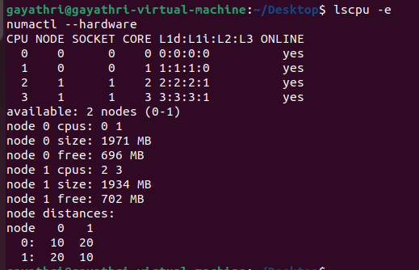
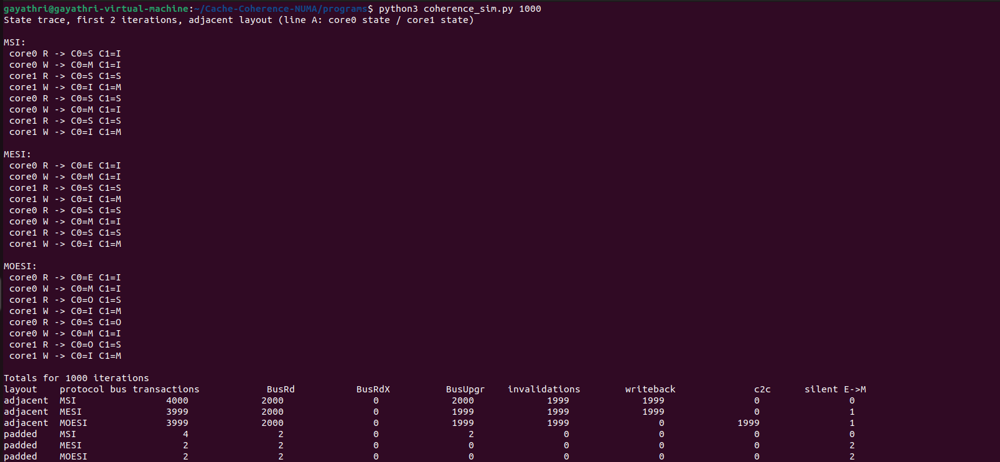
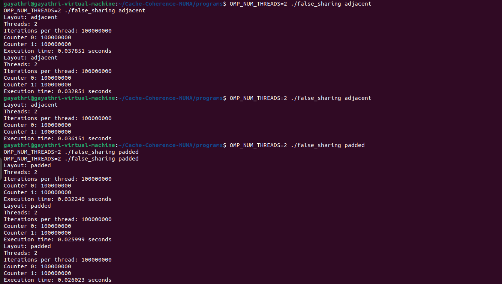
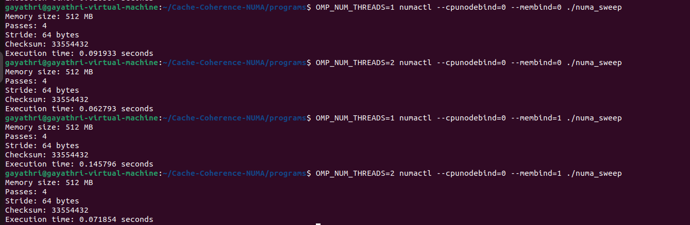
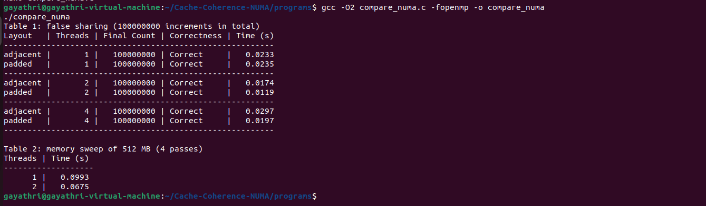

# Cache Coherence and NUMA Memory Performance Analysis

An experimental study of MSI, MESI and MOESI cache coherence protocols, false sharing, and NUMA memory access performance using C, Python, OpenMP and Linux NUMA utilities.

---

## Table of Contents

1. Project Overview
2. Objectives
3. Background Concepts
4. Experimental Environment
5. Project Structure
6. Implementation
7. Build and Execution
8. Experimental Results
9. Performance Analysis
10. Screenshots
11. Limitations
12. Conclusion

---

## 1. Project Overview

Cache coherence and memory locality are important factors affecting the performance of parallel applications.

This experiment investigates three cache coherence protocols — MSI, MESI and MOESI — and studies the impact of false sharing and NUMA memory placement on execution time.

The experiment combines a Python-based cache coherence simulator with C programs using OpenMP and Linux NUMA utilities.

## 2. Objectives

- Understand the working of MSI, MESI and MOESI cache coherence protocols.
- Compare cache behavior for adjacent and cache-line-padded data layouts.
- Investigate false sharing in multithreaded programs.
- Measure the effect of thread count on execution time.
- Compare local and remote NUMA memory access.
- Analyze correctness, performance and scalability.

## 3. Background Concepts

### 3.1 Cache Coherence Protocols

Cache coherence protocols maintain consistency between multiple cached copies of shared memory.

| Protocol | States | Key Characteristic |
|---|---|---|
| MSI | Modified, Shared, Invalid | Basic write-invalidate protocol |
| MESI | Modified, Exclusive, Shared, Invalid | Exclusive state permits a silent E-to-M transition |
| MOESI | Modified, Owned, Exclusive, Shared, Invalid | Owned state allows a dirty cache line to be shared |

### 3.2 False Sharing

False sharing occurs when multiple threads modify different variables that occupy the same cache line.

Although the variables are logically independent, cache coherence operates at cache-line granularity. This can cause unnecessary invalidations and cache-line transfers.

- **Adjacent layout:** Counters are placed next to each other.
- **Padded layout:** Counters are separated using padding so they occupy different cache lines.

### 3.3 NUMA Architecture

Non-Uniform Memory Access (NUMA) is a memory architecture in which memory access time can depend on the memory node's location relative to the CPU.

- **Local access:** A CPU accesses memory associated with its own NUMA node.
- **Remote access:** A CPU accesses memory associated with another NUMA node.

Linux `numactl` is used to control CPU and memory-node placement.

## 4. Experimental Environment

### 4.1 Virtual Machine Configuration

| Component | Configuration |
|---|---|
| Hypervisor | VMware Workstation |
| Guest OS | Ubuntu 22.04.5 LTS |
| Virtual CPUs | 4 |
| Virtual NUMA Nodes | 2 |
| CPUs per Virtual NUMA Node | 2 |
| Allocated RAM | Approximately 4 GB |

### 4.2 Software and Tools

| Tool | Version / Usage |
|---|---|
| GCC | 11.4.0 |
| Python | 3.10.12 |
| OpenMP | Parallel programming |
| numactl | NUMA CPU and memory binding |
| hwloc | Hardware topology inspection |
| C | Benchmark implementation |

## 5. Project Structure

```text
Cache-Coherence-NUMA/
│
├── programs/
│   ├── coherence_sim.py
│   ├── false_sharing.c
│   ├── numa_sweep.c
│   └── compare_numa.c
│
├── results/
│   └── experiment_results.txt
│
├── screenshots/
│   ├── 1_VM_NUMA_Setup.png
│   ├── 2_Coherence_Simulator.png
│   ├── 3_False_Sharing_Results.png
│   ├── 4_NUMA_Results.png
│   └── 5_Comparison_Program.png
│
├── .gitignore
└── README.md
```

## 6. Implementation

### 6.1 Cache Coherence Simulator

**File:** `programs/coherence_sim.py`

A two-core cache coherence simulator was implemented to demonstrate MSI, MESI and MOESI state transitions.

The simulator evaluates two memory layouts:

- Adjacent counters.
- Padded counters.

It records:

- Bus transactions.
- Bus read requests.
- Bus read-exclusive requests.
- Bus upgrades.
- Invalidations.
- Writebacks.
- Cache-to-cache transfers.
- Silent Exclusive-to-Modified transitions.

The simulator was executed with 1,000 iterations.

### 6.2 False Sharing Benchmark

**File:** `programs/false_sharing.c`

An OpenMP program was implemented to compare adjacent and padded counters.

Each of the two threads performs 100 million increments on its own counter.

Three runs were performed for each layout, and the median execution time was used for comparison.

### 6.3 NUMA Memory Sweep

**File:** `programs/numa_sweep.c`

The program performs a memory sweep using:

- Buffer size: 512 MB.
- Number of passes: 4.
- Memory access stride: 64 bytes.

CPU and memory placement are controlled using `numactl`.

### 6.4 Combined Comparison Program

**File:** `programs/compare_numa.c`

The combined program evaluates:

**Table 1 — False Sharing**
- Adjacent and padded layouts.
- 1, 2 and 4 threads.
- 100 million total increments.
- Final counter correctness.

**Table 2 — Memory Sweep**
- 512 MB memory buffer.
- Four passes.
- 1 and 2 threads.

It also supports local and remote NUMA memory placement.

## 7. Build and Execution

### 7.1 Install Dependencies

```bash
sudo apt update
sudo apt install build-essential numactl hwloc python3
```

### 7.2 Compile the C Programs

```bash
cd ~/Cache-Coherence-NUMA/programs

gcc -O2 false_sharing.c -fopenmp -o false_sharing
gcc -O2 numa_sweep.c -fopenmp -o numa_sweep
gcc -O2 compare_numa.c -fopenmp -o compare_numa
```

### 7.3 Run Cache Coherence Simulator

```bash
python3 coherence_sim.py 1000
```

### 7.4 Run False Sharing Benchmark

```bash
OMP_NUM_THREADS=2 ./false_sharing adjacent
OMP_NUM_THREADS=2 ./false_sharing padded
```

### 7.5 Run NUMA Memory Sweep

**Local memory placement:**

```bash
OMP_NUM_THREADS=1 numactl --cpunodebind=0 --membind=0 ./numa_sweep
```

**Remote memory placement:**

```bash
OMP_NUM_THREADS=1 numactl --cpunodebind=0 --membind=1 ./numa_sweep
```

### 7.6 Run Combined Comparison

**Default placement:**

```bash
./compare_numa
```

**Local memory placement:**

```bash
numactl --cpunodebind=0 --membind=0 ./compare_numa
```

**Remote memory placement:**

```bash
numactl --cpunodebind=0 --membind=1 ./compare_numa
```

## 8. Experimental Results

All execution times are in seconds.

### 8.1 Cache Coherence Simulation

Results for 1,000 iterations:

| Layout | Protocol | Bus Transactions | BusRd | BusUpgr | Invalidations | Writebacks | C2C | Silent E→M |
|---|---|---:|---:|---:|---:|---:|---:|---:|
| Adjacent | MSI | 4000 | 2000 | 2000 | 1999 | 1999 | 0 | 0 |
| Adjacent | MESI | 3999 | 2000 | 1999 | 1999 | 1999 | 0 | 1 |
| Adjacent | MOESI | 3999 | 2000 | 1999 | 1999 | 0 | 1999 | 1 |
| Padded | MSI | 4 | 2 | 2 | 0 | 0 | 0 | 0 |
| Padded | MESI | 2 | 2 | 0 | 0 | 0 | 0 | 2 |
| Padded | MOESI | 2 | 2 | 0 | 0 | 0 | 0 | 2 |

The simulator showed substantially fewer bus transactions for padded counters.

MOESI used cache-to-cache transfers in the adjacent workload instead of the writebacks recorded by MSI and MESI.

### 8.2 False Sharing — Standalone Benchmark

Two threads, three runs per layout:

| Layout | Run 1 | Run 2 | Run 3 | Median |
|---|---:|---:|---:|---:|
| Adjacent | 0.033223 | 0.037851 | 0.032851 | 0.033223 |
| Padded | 0.032240 | 0.025999 | 0.026023 | 0.026023 |

**Adjacent / Padded Ratio: 1.277**

The adjacent layout took approximately 1.277 times the median execution time of the padded layout in these runs.

### 8.3 NUMA Memory Sweep — Standalone Benchmark

| Placement | Threads | Checksum | Execution Time |
|---|---:|---:|---:|
| Local | 1 | 33,554,432 | 0.091933 |
| Local | 2 | 33,554,432 | 0.062793 |
| Remote | 1 | 33,554,432 | 0.145796 |
| Remote | 2 | 33,554,432 | 0.071854 |

The checksum remained identical across all configurations.

These are individual recorded runs, not three-run medians.

### 8.4 Combined Program — False Sharing Comparison

100 million total increments:

| Layout | Threads | Final Count | Correctness | Time |
|---|---:|---:|---|---:|
| Adjacent | 1 | 100,000,000 | Correct | 0.0241 |
| Padded | 1 | 100,000,000 | Correct | 0.0226 |
| Adjacent | 2 | 100,000,000 | Correct | 0.0154 |
| Padded | 2 | 100,000,000 | Correct | 0.0137 |
| Adjacent | 4 | 100,000,000 | Correct | 0.0301 |
| Padded | 4 | 100,000,000 | Correct | 0.0174 |

All six configurations produced the expected final count.

These values are from one recorded default-placement run.

### 8.5 Combined Program — Default Memory Sweep

| Threads | Execution Time |
|---:|---:|
| 1 | 0.0991 |
| 2 | 0.0727 |

### 8.6 Combined NUMA Comparison

Median of three runs:

| Placement | 1 Thread | 2 Threads |
|---|---:|---:|
| Local | 0.0978 | 0.0733 |
| Remote | 0.0988 | 0.0771 |

**Remote / Local Ratio:**

| Threads | Ratio |
|---:|---:|
| 1 | 1.010 |
| 2 | 1.052 |

The combined measurements showed remote access to be approximately 1.0% slower with one thread and 5.2% slower with two threads.

## 9. Performance Analysis

### 9.1 Cache Coherence

The simulator showed that adjacent counters caused repeated coherence activity because both counters shared a cache line.

Padding separated the counters and substantially reduced simulated bus transactions.

MESI reduced one transaction compared with MSI in the adjacent workload due to its Exclusive state and silent E-to-M transition.

MOESI recorded cache-to-cache transfers and zero writebacks in the adjacent workload.

### 9.2 False Sharing

The standalone benchmark recorded a median time of 0.033223 seconds for adjacent counters and 0.026023 seconds for padded counters.

The combined benchmark also showed lower execution times for padded counters at 2 and 4 threads.

The 4-thread adjacent configuration was slower than the 2-thread configuration, demonstrating that increasing the number of threads does not always improve performance.

### 9.3 NUMA Performance

The combined NUMA measurements showed a small local-memory advantage.

Two threads improved memory sweep execution time compared with one thread in the recorded combined measurements.

The standalone NUMA results showed a larger difference, but execution times varied across tests. The combined results therefore provide a more cautious comparison using three-run medians.

## 10. Screenshots

### 10.1 Virtual Machine and NUMA Configuration



### 10.2 Cache Coherence Simulator



### 10.3 False Sharing Results



### 10.4 NUMA Memory Sweep Results



### 10.5 Combined Comparison Program



## 11. Limitations

- The experiment was executed inside a VMware virtual machine.
- The two NUMA nodes are virtual NUMA nodes and may not correspond to physically independent memory nodes on the host.
- Therefore, the results should not be interpreted as measurements from a physical multi-socket NUMA system.
- Execution times can vary due to virtual machine scheduling, system load and memory placement.
- The simulator models protocol behavior; its transaction counts are not direct measurements of hardware cache-coherence events.
- Some benchmark results are single runs, while the explicitly labelled median results use three runs.

## 12. Conclusion

This experiment demonstrated the behavior of MSI, MESI and MOESI cache coherence protocols through simulation and examined the impact of false sharing and NUMA memory placement using parallel C programs.

The simulation showed that padding can significantly reduce cache-line sharing and coherence traffic. The benchmark results also showed improved performance for padded counters in the recorded multithreaded tests.

The NUMA measurements demonstrated a small local-memory advantage in the combined experiment, while also highlighting the limitations of virtual NUMA environments.

Overall, the experiment illustrates the importance of cache-aware data layout, memory locality and careful performance measurement in parallel computing.

---

**Repository:** [Cache-Coherence-NUMA](https://github.com/gayathri-davara/Cache-Coherence-NUMA)
